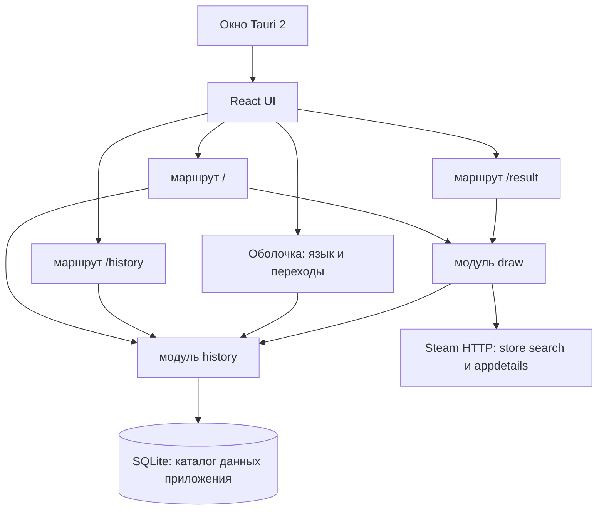

# Архитектура — Случайная игра Steam

Продукт — одна локальная программа в одном окне операционной системы. Это не система микросервисов и не сайт. Источники: `docs/requirements.md`, `docs/pages-spec.md`, `docs/tech-stack.md`, `.project/deploy.json` (`target: local`, брокер выключен, объектного хранилища нет, CI нет, домена нет), экраны и макеты в `prototype/src/pages/` и `prototype/src/data/mock.ts`.

Модули ровно два: `draw` и `history`. Учётной записи нет. Сервера продукта нет.

Каркас микросервисов из `templates/docs/` к этой программе не применяется. Шаблоны шлюза и сервисных HTTP API не используются.

## Принципы

| Принцип | Реализация |
|---------|------------|
| Один процесс | Один процесс Tauri 2. React, Vite, TypeScript и Tailwind рисуют интерфейс внутри окна. Rust — оболочка окна, файла SQLite и HTTP к витрине. Правила розыгрыша и тексты живут на TypeScript |
| Один интерфейс | Три маршрута окна: `/`, `/result`, `/history`. Оболочка (имя продукта, язык, переходы) есть на каждом маршруте. Отдельной телефонной вёрстки и публичного сайта нет |
| Одно локальное хранилище | Один файл SQLite в каталоге данных приложения. Его открывает только `history`. Второй базы нет |
| Каталог на время розыгрыша | Публичная витрина Steam читается в момент розыгрыша. Подходящие игры держатся в памяти этого розыгрыша и затем сбрасываются. Локальной базы всего каталога нет |
| Без аккаунта | Нет пользователя, входа, регистрации, пароля, ролей и JWT. Кто запустил окно на этом компьютере, тот и владелец установки |
| Ярлык | Установщик Tauri создаёт ярлык рабочего стола. Ярлык открывает окно сразу на `/` |

Граница цены, переключатель «Только бесплатные» и язык переживают перезапуск, потому что лежат в SQLite. Текущая карточка результата живёт только в памяти этого запуска окна.

Прототип хранит цену, язык и историю в `localStorage` и показывает выдуманный каталог из `prototype/src/data/mock.ts`. В продукте этого нет: каталог приходит из Steam на время розыгрыша, история и настройки — из SQLite. Поля макета `initials`, `color`, `noteRu`, `noteEn` и стартовые три записи в продукт не переносятся.

## Что отклонено

Эти части каркаса репозитория для «Случайной игры Steam» не используются.

| Отклонено | Почему |
|-----------|--------|
| PostgreSQL и отдельная база на модуль | Один файл SQLite. Отдельный сервер СУБД не запускается |
| JWT, вход и пользователь | Учётной записи нет |
| API-шлюз и BFF | Окно вызывает команды Tauri двух модулей. Своего HTTP API нет |
| Docker Compose | Поставка — установщик и ярлык, не набор контейнеров |
| Сервер продукта | История и настройки не уходят с компьютера |
| RabbitMQ и любой брокер | `.project/deploy.json`: `messageBroker: false`. События остаются внутри процесса |
| S3 и объектное хранилище | `.project/deploy.json`: `objectStorage: false`. Обложка — URL витрины или короткая локальная пометка в строке истории |
| Electron и окно браузера на localhost | В `docs/tech-stack.md` выбран Tauri 2 |

Домена нет, CI нет. Читать библиотеку Steam, входить в Steam и проводить оплату программа не умеет.

## Карта процесса

Окно ведёт на маршруты. Маршруты вызывают локальные модули. `history` пишет файл SQLite. `draw` читает публичный HTTP Steam и на время розыгрыша спрашивает `history`.

Ссылка на страницу игры открывается браузером системы из оболочки окна. Окно программы при этом не закрывается. Это не третий модуль и не сервер.

## Сводная таблица модулей

| Модуль | Bounded context | Хранилище | Агрегаты | Экраны |
|--------|-----------------|-----------|----------|--------|
| `draw` | Один розыгрыш: чтение витрины, фильтры, равновероятный выбор одной игры, карточка этого запуска | Своей базы нет. Каталог только в памяти на время розыгрыша. Текущая карточка — память процесса, не файл | Игра витрины (только чтение), карточка текущего розыгрыша | `/`, `/result` |
| `history` | Уже показанные игры и локальные настройки этого компьютера | Один файл SQLite `random-steam-game.db` в каталоге данных приложения. Таблицы `snake_case`, первичный ключ UUID текстом. Второй базы нет | Запись розыгрыша, локальные настройки | `/` (граница цены и «Только бесплатные»), `/history`, оболочка всех маршрутов (язык) |

Имена модулей в `.project/state.json`: `draw`, `history`.

## Модуль `draw`

Контекст одного розыгрыша. Модуль не хранит каталог, не ведёт настройки и не удаляет историю.

На один вызов розыгрыша `draw` делает следующее.

1. Берёт у `history` множество `steam_app_id` уже сохранённых записей и текущие настройки.
2. Если «Только бесплатные» выключено, а граница цены пустая, отрицательная или нечисловая, розыгрыш не начинается. К Steam обращений нет, запись не создаётся.
3. Читает публичную витрину в долларах США и собирает кандидатов в памяти.
4. Оставляет игры, которые уже вышли, имеют текущую цену USD и проходят границу или режим «только бесплатные».
5. Вычитает историю.
6. Если после этого список пуст, возвращает пустую выборку. Запись не создаётся.
7. Если чтение витрины оборвалось, возвращает недоступность Steam. Частичный список сбрасывается, запись не создаётся.
8. Выбирает ровно одну игру с равной вероятностью среди оставшихся.
9. Просит `history` вставить снимок. Если вставка не удалась, карточка не выдаётся, игра не считается показанной, текущая карточка сеанса не меняется.
10. Запоминает карточку как результат этого запуска окна и возвращает её вместе с лентой обложек из той же выборки.

Рулетка выбор не повторяет. Обложки в ленте берутся из той же отфильтрованной выборки. Если в выборке одна игра, лента всё равно останавливается на её обложке. Победитель в ленте — уже выбранная игра, а не новый жребий. После ответа память каталога этого розыгрыша освобождается. На диск пишется только снимок через `history`.

Пока идёт чтение витрины, второй розыгрыш не стартует. Повторный вызов в этот момент ничего не читает и ничего не вставляет.

### Чтение витрины

Ключ Steam, cookie входа и библиотека владельца не используются.

Оболочка Rust выполняет HTTP, чтобы запрос не упирался в CORS окна. Для `draw` это транспорт, не отдельный модуль и не сервис в `services`.

Два публичных чтения:

- Store search. Страницы поиска магазина с `cc=US`, только игры, постранично, пока магазин не кончит выдачу. Подходящий вход — `https://store.steampowered.com/search/results/` с `json=1`, `infinite=1`, `ignore_preferences=1`, `category1=998`, `cc=US`, `start` и `count`. Структурный `https://store.steampowered.com/api/storesearch/` допустим как тот же поиск, если он отдаёт идентификаторы без подбора слов. Список поисковых слов не используется: он перекашивает равную вероятность.
- Appdetails. Для каждого нового идентификатора, которого нет в истории: `https://store.steampowered.com/api/appdetails?appids={id}&cc=US`. Ответ `success: false` означает, что позицию пропустить. Сетевой сбой, HTTP 429 или 5xx останавливает весь розыгрыш.

Цены запрашиваются в USD (`cc=US`). Курс программа не считает.

Подсказка цены в запросе поиска только сужает страницы. Окончательное сравнение делается локально по данным appdetails. При выключенном переключателе в поиск можно передать границу как подсказку. При включённом «Только бесплатные» поиск просит бесплатные игры, а граница в запрос не подставляется.

### Кого оставлять в выборке

Позиция остаётся, только если одновременно:

- `type` равен `game`. Дополнения, саундтреки, видео, демо, наборы, программы и любой другой тип отбрасываются;
- игра уже вышла: `release_date.coming_soon` ложен. Ранний доступ при этом остаётся. Предзаказ до релиза не входит;
- есть текущая цена в USD. Бесплатная игра (`is_free` или цена `0`) получает `0`. Иначе берётся `price_overview.final` при валюте `USD`, делённая на 100. Это цена со скидкой, если скидка действует. Другая валюта или отсутствие цены исключает позицию;
- при выключенном «Только бесплатные» цена в центах не выше границы в центах, сравнение включительно. Граница `0` оставляет бесплатные. Бесплатные входят при любой неотрицательной границе;
- при включённом «Только бесплатные» цена равна `0`. Граница не смотрится;
- `steam_app_id` нет среди идентификаторов `history`.

Игры 18+ не отфильтровываются и на карточке не помечаются. Название берётся как есть, без перевода. Обложка — `header_image`. Ссылка — `https://store.steampowered.com/app/{steam_app_id}`.

Сравнение цены идёт в целых центах, чтобы дробный USD не расходился из-за двоичной дроби.

### Карточка, которую возвращает модуль

| Поле | Смысл |
|------|--------|
| `id` | UUID записи, который вернул `history` |
| `steam_app_id` | Идентификатор Steam |
| `name` | Название с витрины |
| `price_usd` | Цена на момент розыгрыша, `0` — бесплатно |
| `cover` | URL обложки или локальная пометка, если URL не пришёл |
| `store_url` | Ссылка на страницу игры |
| `rolled_at` | Момент, который проставил `history` при вставке |

Отдельно возвращается лента: короткие элементы той же выборки (`steam_app_id`, `name`, `cover`) с выбранной игрой в слоте остановки. Лента на диск не пишется.

`draw` помнит последнюю успешную карточку этого процесса. Перезапуск окна её забывает. Это не чтение последней строки SQLite: старые строки — история, а не результат текущего сеанса.

### Итоги вызова розыгрыша

| Итог | Когда | Запись в истории |
|------|--------|------------------|
| Карточка и лента | Выбор и вставка прошли | Создана |
| Негодная граница | Переключатель выключен, границы нет или она невалидна | Нет |
| Пустая выборка | Чтение удалось, после фильтров и истории игр не осталось | Нет |
| Витрина недоступна | Сеть, отказ HTTP или оборванная страница | Нет |
| Ошибка записи | Steam уже выбрал игру, но вставка в `history` не прошла | Нет |
| Розыгрыш уже идёт | Повторный вызов, пока читается витрина | Нет |

Пустая выборка сообщает вызывающему, включён ли «Только бесплатные», чтобы экран `/` показал нужный текст: поднять границу или открыть историю, либо выключить переключатель или открыть историю.

Повтор после ошибки витрины — снова тот же вызов розыгрыша с уже сохранёнными настройками. Он сам не стартует.

### Команды, которые видит окно

| Команда | Кто вызывает | Действие |
|---------|--------------|----------|
| `draw_roll` | `/` | Розыгрыш по правилам выше. Аргументов нет: граница и переключатель уже лежат в `history` |
| `draw_current` | `/result` | Карточка этого запуска или пусто |

Разбор запятой и точки в поле цены делает экран `/` до сохранения числа. В модуль уходит уже сохранённое число из настроек.

## Модуль `history`

Контекст сохранённых розыгрышей и настроек. Один файл SQLite, одно соединение плагина SQL Tauri 2 (`sqlite`). Путь — каталог данных приложения, имя файла `random-steam-game.db`. Файл `-wal` рядом, если SQLite его создаст, остаётся служебным журналом этого же файла, а не второй базой.

При старте окна модуль создаёт таблицы, если их нет, и гарантирует одну строку настроек.

Пользователя, каталога игр и корзины в файле нет. Удаление физическое: `DELETE`. Мягкого удаления, архива и восстановления нет. Удаление ничего не меняет в Steam.

### Таблица `settings`

Одна строка на установку. Создаётся при первом запуске. Не удаляется. Смена цены, переключателя или языка обновляет эту же строку.

| Колонка | Тип | Ограничения | Смысл |
|---------|-----|-------------|--------|
| `id` | TEXT | PK, UUID | Ключ единственной строки |
| `max_price_usd` | REAL | `NULL` или `>= 0` | Верхняя граница USD. Пусто, пока владелец её не задаст |
| `free_only` | INTEGER | NOT NULL, `0` или `1`, по умолчанию `0` | «Только бесплатные» |
| `language` | TEXT | NOT NULL, `ru` или `en` | Язык интерфейса |
| `created_at` | TEXT | NOT NULL | Момент создания строки, ISO-8601 с локальным смещением |
| `updated_at` | TEXT | NOT NULL | Момент последнего изменения |

Первый запуск: `max_price_usd` = `NULL`, `free_only` = `0`. Язык — язык ОС, если он русский или английский, иначе `ru`. Дальше язык меняется только из оболочки.

Вставка второй строки запрещена. Если строки нет, модуль создаёт её в одной транзакции.

Число хранится как число, не как строка с запятой. Пустое поле на экране — это `NULL`, а не ноль. Ноль — заданная граница.

### Таблица `rolls`

Снимок одного показа. Строка не обновляется. Пока она есть, этот `steam_app_id` в новые розыгрыши не входит.

| Колонка | Тип | Ограничения | Смысл |
|---------|-----|-------------|--------|
| `id` | TEXT | PK, UUID | Локальный ключ записи |
| `steam_app_id` | INTEGER | NOT NULL, UNIQUE | Игра, которую исключают дальше. Не внешний ключ |
| `name` | TEXT | NOT NULL | Название на момент розыгрыша |
| `price_usd` | REAL | NOT NULL, `>= 0` | Цена USD на момент розыгрыша |
| `cover` | TEXT | NOT NULL | URL обложки `https://...` либо короткая локальная пометка, если витрина не дала URL |
| `store_url` | TEXT | NOT NULL | Ссылка на страницу игры |
| `rolled_at` | TEXT | NOT NULL | Локальные дата и время компьютера, ISO-8601 со смещением |

Индекс по `rolled_at` убыванию нужен списку истории. Уникальность `steam_app_id` держит правило «не больше одной действующей записи на игру».

`created_at` и `updated_at` у `rolls` нет: запись не меняется, время показа — это `rolled_at`.

`cover` — одна колонка. Если значение начинается с `https://`, экран показывает картинку. Иначе это локальная пометка, и строка всё равно показывает название, цену, дату и ссылку. Отдельного файла обложки нет.

### Команды, которые видит окно

| Команда | Кто вызывает | Действие |
|---------|--------------|----------|
| `history_get_settings` | `/`, оболочка | Одна строка настроек. При первом запуске создаёт её |
| `history_update_settings` | `/`, оболочка | Частичное обновление: `max_price_usd`, `free_only`, `language`. Негодную цену и неизвестный язык отклоняет. Строку не удаляет |
| `history_list` | `/history` | Записи от новых к старым. Сеть не нужна |
| `history_delete` | `/history` | Физически удаляет одну запись по `id` |
| `history_clear` | `/history` | Физически удаляет все записи. Настройки не трогает. Подтверждение спрашивает экран до вызова |

Внутри процесса, не как HTTP и не как команды экрана истории:

| Вызов | Кто вызывает | Действие |
|-------|--------------|----------|
| Список `steam_app_id` | `draw` перед чтением витрины | Множество идентификаторов для исключения |
| Вставка снимка | `draw` после выбора | UUID, `rolled_at`, одна транзакция. Конфликт уникальности `steam_app_id` — ошибка вставки |

Вставка принимает снимок без локального `id` и без `rolled_at`: их назначает `history`. Поля снимка: `steam_app_id`, `name`, `price_usd`, `cover`, `store_url`.

Экран `/` сохраняет границу через `history_update_settings` только когда «Только бесплатные» выключено и владелец нажал «Разыграть» с допустимым числом. Включённый переключатель границу не перезаписывает. Сам переключатель пишется в настройки сразу, как и язык оболочки.

Список, удаление и очистка работают без Steam. Ошибка обложки на экране не удаляет строку.

## Как модули связаны

`draw` не открывает SQLite. Перед чтением витрины он спрашивает у `history` идентификаторы. После выбора одной игры он просит `history` вставить снимок. Оба вызова синхронные и внутри того же процесса. HTTP между модулями нет.

Внешних ключей нет. `rolls.steam_app_id` — обычное число в снимке, не ссылка на таблицу каталога. Таблицы каталога нет, базы `draw` нет, поэтому кросс-базовых ключей тоже нет.

Снимок самодостаточен: история открывается без витрины. Позже исчезнувшая страница Steam не стирает название, цену, обложку или ссылку из строки. Удаление строки не меняет Steam и не требует действия от `draw`: следующий розыгрыш просто не увидит этот идентификатор.

Настройки в розыгрыш не вложены. `draw` читает границу и флаг на старте вызова и сам их не хранит.

Текущая карточка сеанса в `draw` совпадает с только что вставленной строкой, но `/result` берёт её из памяти `draw`, а не ищет «последнюю» строку истории.

Гонка на одном окне безопасна в узкую сторону. Идентификаторы фиксируются в начале розыгрыша. Очистка истории во время долгого чтения может лишь зря исключить игру из этого розыгрыша. Следующий розыгрыш прочитает идентификаторы заново. Две вставки одной игры не проходят из-за уникальности `steam_app_id`.

## Доменные события

События идут внутри процесса: прямой вызов подписчиков или событие Tauri в этом же окне. Брокера нет. RabbitMQ отклонён. События не уходят на другой компьютер и не синхронизируют вторую базу.

| Событие | Издатель | Когда | Подписчики |
|---------|----------|-------|------------|
| `RollCompleted` | `draw` | Вставка снимка прошла, карточка сеанса записана | Окно: лента и переход на `/result`. `history` уже записал строку прямым вызовом и на событие не подписывается |
| `HistoryEntryDeleted` | `history` | Одна строка физически удалена | Экран `/history` |
| `HistoryCleared` | `history` | Удалены все строки розыгрышей | Экран `/history` |
| `SettingsUpdated` | `history` | Изменились граница, «Только бесплатные» или язык | Оболочка и экран `/` |

Полезные данные:

- `RollCompleted` — карточка с `id`, `steam_app_id`, `name`, `price_usd`, `cover`, `store_url`, `rolled_at`.
- `HistoryEntryDeleted` — `id` и `steam_app_id`.
- `HistoryCleared` — без списка строк.
- `SettingsUpdated` — строка настроек целиком.

`draw` не слушает удаления, чтобы поправить каталог: каталога нет. Ошибка вставки, пустая выборка и недоступность Steam событий не порождают.

Смена языка во время кручения ленты публикует `SettingsUpdated` и не отменяет уже выбранную игру.

## Вызов из окна

API-шлюза нет. JWT нет. Префикса `/api` нет. Собственного HTTP-сервера нет. Экраны вызывают команды Tauri модулей `draw` и `history`.

| Место окна | Модуль | Команды и зачем |
|------------|--------|-----------------|
| Оболочка на `/`, `/result`, `/history` | `history` | Прочитать и сохранить язык |
| `/` | `history` | Прочитать границу и «Только бесплатные», сохранить их |
| `/` | `draw` | `draw_roll`: одна игра, лента, пустая выборка, ошибка витрины, ошибка записи |
| `/result` | `draw` | `draw_current`: карточка этого запуска или пустое состояние сеанса |
| `/history` | `history` | Список, удаление одной записи, очистка всех |

Переход «Новый розыгрыш» с `/result` только открывает `/` и розыгрыш не вызывает. Переход «История» открывает `/history`. Пока лента крутится, оба перехода ждут остановки. Смена языка в этот момент разрешена.

Ссылку `store_url` открывает оболочка в браузере системы и с `/result`, и с `/history`.

Каждый экран связан хотя бы с одним модулем: `/` с `draw` и `history`, `/result` с `draw`, `/history` с `history`. Язык оболочки на всех трёх маршрутах читается и пишется через `history`.
